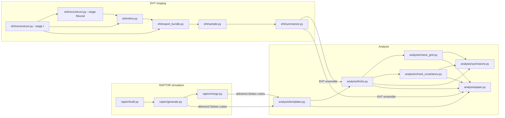

# Overview and Concepts

[← Documentation index](index.md)

The M87\* EHT axion pipeline tests for birefringent electric-vector position angle (EVPA) oscillations induced by an ultralight axion cloud around M87\*. Two independent upstream parts — polarized ray tracing of a general-relativistic magnetohydrodynamic (GRMHD) accretion flow (`RAPTOR` simulation) and polarimetric reconstruction of the 2017 Event Horizon Telescope (EHT) observations (EHT imaging) — can execute in any order or in parallel. The downstream analysis combines both into Bayesian upper limits $c_{95}(\alpha)$ on the dimensionless coupling $c$.

## Pipeline architecture

| Part | Scripts | Pixi environment | Primary outputs |
|---|---|---|---|
| `RAPTOR` simulation | `scripts/raptor/build.py`, `scripts/raptor/generate.py`, `scripts/raptor/merge.py` | `raptor-build` (`linux-64`) | Delivered float64 Stokes cubes (`res-100/alpha-*/stokes.npy`, `res-400/background/...`) |
| EHT imaging | `scripts/eht/reconstruct.py`, `scripts/eht/refine.py`, `scripts/eht/export_bundle.py`, `scripts/eht/sample.py` | `eht-imaging` | Fixed-$I$ images, refined fiducial D terms, and $4 \times 1000$ certified polarimetric FITS draws |
| EHT ensemble summary | `scripts/eht/summarize.py` | `eht-summary` | Per-day Stokes/EVPA arrays and Paper VII diagnostics (`eht/ensemble/`) |
| Analysis | `scripts/analysis/templates.py`, `scripts/analysis/limits.py`, `scripts/analysis/check_grid.py`, `scripts/analysis/check_covariance.py`, `scripts/analysis/summarize.py`, `scripts/analysis/paper.py` | `default` | Response templates, upper limits $c_{95}(\alpha)$, sensitivity checks, `RESULTS.md`, and paper figures/macros/tables |
| Verification | `scripts/verify_products.py` | `default` | Read-only manifest and SHA-256 lineage validation |

Arrows mean "reads the verified output of". When all ray-tracing jobs execute under a single run root, `scripts/raptor/generate.py` delivers the Stokes cubes directly; when jobs are split across hosts or builds, `scripts/raptor/merge.py` merges their job roots into one delivered tree. `scripts/analysis/paper.py` also reads the frozen `RAPTOR` plan, `src/axion.c` of the pinned `RAPTOR` checkout, the radial-profile CSVs, and the delivered 400-pixel axion-off cubes.

## Scientific workflow

1. **`RAPTOR` simulation** ([RAPTOR simulation](raptor-simulation.md)). Across 141 BHAC GRMHD snapshots (`data001600.dat` to `data003000.dat` in steps of 10 labels, $1\,t_g$ cadence), the pinned `RAPTOR` C core ray-traces:
   - one axion-off baseline image at $100 \times 100$ pixels and one at $400 \times 400$ pixels per snapshot;
   - one axion-on response image at $100 \times 100$ pixels for each of the 8 values of $\alpha \in \{0.10, \dots, 0.44\}$ and each of 16 uniformly spaced axion phases $\psi_k = k\pi/8$ ($k = 0, \dots, 15$).
   This yields $141 \times (2 + 8 \times 16) = 18\,330$ content-addressed tasks, delivered as float64 Stokes $(I, Q, U, V)$ cubes in $\mathrm{Jy\,sr^{-1}}$.
2. **EHT imaging** ([EHT imaging](eht-imaging.md)). Reproduces the EHT Paper VII polarimetric imaging workflow on `ehtim` 1.3.2 for the four 2017 observing days (`95`, `96`, `100`, `101`, corresponding to April 5, 6, 10, 11):
   - reconstructs a fixed total-intensity ($I$) image per day and solves shared $R=L$ station gains;
   - runs 50 rounds of fiducial linear-polarization ($P = Q + iU$) imaging and forward D-term (instrumental leakage) fitting for `AZ`, `LM`, and `PV`;
   - refines each day's fiducial D terms with 100 outer rounds of an exact convex PDHG $P$ solver (certified by a floating-point duality gap) and `L-BFGS-B` forward D refits;
   - samples 1000 D-term realizations per day from the four-day refined scatter (plus zero-mean 1 % residuals on pre-corrected stations `AA`, `AP`, `SM`, `JC`) and solves one certified exact $P$ image per draw.
3. **Analysis** ([Analysis](analysis.md)). Simulated Stokes cubes are blurred with the shared $19\,\mu\mathrm{as}$ matching Gaussian, rotated onto the sky ($108^\circ$), and resampled onto the $64 \times 64$, $120\,\mu\mathrm{as}$ EHT sky grid. A 16-phase discrete Fourier transform extracts the first-harmonic EVPA response amplitude $A$ and phase $\phi$ per pixel (2D) and per intensity-weighted $10^\circ$ sector aperture (1D), which are averaged over snapshots into templates. High-SNR concentrated features are selected on the EHT ensemble without inspecting day-to-day differences. From the two consecutive-day EVPA differences ($96 - 95$ and $101 - 100$) and three covariance models (`std`, `cor`, `cor_fixed_background`), a Gaussian likelihood marginalized over a shared axion phase $\phi_0$ and combined with a log-uniform prior yields the 95 % credible upper limit $c_{95}(\alpha)$, alongside a zero-data control and grid, prior, and split-ensemble covariance checks.

## Physical and polarimetric conventions

### Physical scales and axion model

Note that the speed of light $c$ in $r_g = GM/c^2$ and $t_g = GM/c^3$ is distinct from the dimensionless model coupling $c$.

| Symbol / term | Value / unit | Code / YAML reference | Definition |
|---|---|---|---|
| $M$ | $6.5 \times 10^9\,M_\odot$ | `shared.mass_solar` | M87\* black-hole mass |
| $D$ | $16.8\,\mathrm{Mpc}$ | `shared.distance_mpc` | Distance to M87\* (written to `RAPTOR` `model.in` in $\mathrm{kpc}$) |
| $t_g$ | $8.893\,\mathrm{h}$ ($32\,015.7\,\mathrm{s}$) | `PhysicalScale.tg_hours` | Gravitational time scale $GM/c^3$ |
| $r_g$ | $3.819\,\mu\mathrm{as}$ | `PhysicalScale.angular_rg_uas` | Angular gravitational radius $GM/(c^2 D)$ on the sky |
| $\alpha$ | $0.10, \dots, 0.44$ (dimensionless) | `shared.alphas` | Gravitational fine-structure constant $GM\mu/(\hbar c)$; $\mu c^2 = \alpha \times 2.056 \times 10^{-20}\,\mathrm{eV}$ |
| 211 state | $n = 2, l = 1, m = 1$ | `shared.principal_n` | Superradiant scalar bound state ($n = n_r + l + 1 = 2$) |
| $\Omega(\alpha)$ | dimensionless; $\omega = \Omega/t_g$ ($\mathrm{rad\,h^{-1}}$) | `physics.omega` | Leading small-$\alpha$ oscillation frequency $\Omega(\alpha) = \alpha\bigl(1 - \alpha^2/(2n^2)\bigr)$ |
| $c$ | dimensionless | `g`, `couplings` in `likelihood.py` | Model coupling scaling the axion-induced EVPA oscillation; no conversion to $\mathrm{GeV}^{-1}$ is performed |
| $c_{95}$ | dimensionless | `c95`, `log10_c95` | Posterior quantile of $c$ at `analysis.inference.credibility` ($0.95$) |
| $b(\alpha)$ | dimensionless | `analysis.cloud` | Cloud amplitude scaling $0.03\,(\alpha / 0.05)^{1.75}$ (`cloud_amplitude_scaling`) |
| $N_{\mathrm{ref}}$ | $0.1$ (dimensionless) | `raptor.response.reference_norm` | `RAPTOR` `AXION_NORM` reference field normalization; response templates are per unit $N_{\mathrm{ref}}$ |
| $\psi_k$, $\phi_0$ | $\mathrm{rad}$ | `AXION_PHASE`, `phase_count` | Simulation phase $\psi_k = k\pi/8$ ($k = 0, \dots, 15$); inference nuisance phase $\phi_0 \in [0, 2\pi)$ |

### Polarimetric observables and coordinate conventions

All angles stored in `.npy` and `.npz` products are in radians. Sky position angles are measured east of north.

| Symbol / term | Unit / range | Code reference | Definition |
|---|---|---|---|
| $I, Q, U, V$ | $\mathrm{Jy\,sr^{-1}}$ (`RAPTOR`) or FITS `BUNIT` (`Jy/pixel`, EHT) | `stokes.npy` | Stokes parameters; channel axis order is always `[I, Q, U, V]` |
| $P$ | Stokes brightness units | `Q + 1j * U` | Complex linear polarization; $\lvert P\rvert = \sqrt{Q^2 + U^2}$ |
| $\chi$ (EVPA) | $\mathrm{rad}$, period $\pi$ | `evpa.finite_evpa` | Electric-vector position angle $\frac{1}{2}\arg(Q + iU)$; `NaN` where $Q = U = 0$ (and where $I \le 0$ in `eht:ensemble`) |
| $\operatorname{wrap}_\pi(\Delta\chi)$ | $[-\pi/2, \pi/2)\,\mathrm{rad}$ | `evpa.circular_difference` | Principal-branch $\pi$-periodic angle difference |
| $R$ | $[0, 1]$ | `observations.moments` | Circular resultant length $\lvert\langle e^{2i\chi}\rangle\rvert$ across Monte Carlo draws ($1$ for identical EVPAs) |
| $\lvert m\rvert_{\mathrm{net}}$, $\langle\lvert m\rvert\rangle$ | dimensionless | `ensemble.global_diagnostics` | Net ($\lvert\sum_i P_i\rvert / \sum_i I_i$) and resolved ($\sum_i \lvert P_i\rvert / \sum_i I_i$) fractional polarization (Paper VII eqs. 12–13) |
| $\beta_2$ | complex, dimensionless | `ensemble.global_diagnostics` | Azimuthal $m=2$ polarization mode $\sum_i P_i e^{-2i\varphi_i} / \sum_i I_i$ about the grid centre (Paper VII eq. 14) |

**Spatial array orientation:**
- **Native EHT FITS and ensemble arrays** (`day-*/stokes.npy`) have spatial axes `[y, x]` on `RA---SIN` / `DEC--SIN`: east offset decreases along `x` and north offset increases along `y`.
- **Preprocessed simulation and template arrays** have spatial axes `[x, y]`, where axis `0` points west (`x = -East`) and axis `1` points north (`y = +North`). Transposing a native EHT map (`[y, x] -> [x, y]`) places data and templates on the identical sky coordinate grid without any Stokes sign flip.
- **Zero-shift centring:** EHT images are used directly on the reconstructed $64 \times 64$, $120\,\mu\mathrm{as}$ grid without cross-correlation shifting (see [EHT imaging](eht-imaging.md#known-deviations-from-eht-paper-vii)).

## Core design rules

- **Single source of scientific parameters**: every physical constant of the model, solver tolerance, grid resolution, and prior bound is defined once in [`configs/experiment.yaml`](../../configs/experiment.yaml) and validated strictly by `eht_axion/experiment.py` (see [Configuration](configuration.md)).
- **No scientific defaults in library code**: public functions in `eht_axion/` accept all scientific parameters explicitly from the calling script; `tests/test_experiment.py` inspects the AST of `eht_axion/` and rejects numeric default arguments outside a small execution/layout allow-list.
- **Strict separation of machine environment**: file paths, thread counts, worker counts, CPU pinning, and memory caps live exclusively in CLI options and the single `.env` data file — never in `configs/experiment.yaml`. All paths derive from three roots: the `RAPTOR` checkout (`EHT_RAPTOR_SOURCE_ROOT`), the read-only external inputs (`EHT_INPUT_ROOT`), and the generated products (`EHT_DATA_ROOT`).
- **Immutable stages and cryptographic provenance**: result scripts write only to new directories via `stage_directory`, require a clean tracked git working tree (`code_identity`), and emit `manifest.json` containing the full `git_commit` and SHA-256 digests of every external input and stage output (see [Data layout and provenance](data-layout.md)).
