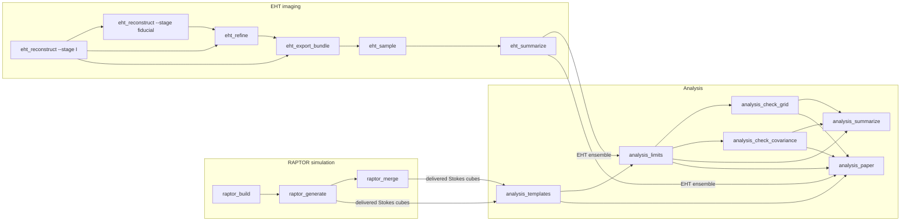

# Overview

## Purpose

This page explains what the repository computes, which parts it consists of, and how the
products of the parts connect. RAPTOR simulation and EHT imaging are two independent
inputs that do not read each other's products; they can run in any order or at the same
time. The analysis reads the products of both and produces upper limits on the coupling
$c$ of an axion-induced EVPA oscillation in M87\*.

## Inputs

- BHAC GRMHD snapshots of the M87\* accretion flow (`data<label>.dat`, labels 1600 to 3000
  in steps of 10) and two radial-profile tables of the axion field, read by the RAPTOR part.
- The four EHT 2017 M87\* low-band HOPS uvfits files of April 5, 6, 10 and 11 (days 95, 96,
  100, 101), the EHT feed-rotation table and the official EHT imaging script, read by the
  EHT imaging part.
- `experiment.yaml`, the single parameter file, read by every script
  ([Experiment configuration](experiment-config.md)).

## Outputs

- Delivered RAPTOR Stokes cubes (`data/raptor/res-*/alpha-*/` and `data/raptor/res-400/background/`), see
  [RAPTOR simulation](raptor-simulation.md).
- The EHT ensemble: 1000 D-term Monte Carlo images per day, summarized per day, see
  [EHT imaging](eht-imaging.md).
- Response templates, likelihood features, limits $c_{95}(\alpha)$ for six cases
  (1D and 2D observables, three covariance models), their numerical checks and the
  figures, numbers and tables of the paper, see [Analysis](analysis.md).

## How to run

Each part has its own Pixi environment and scripts. Full command lines are in the "How to
run" sections of [RAPTOR simulation](raptor-simulation.md), [EHT imaging](eht-imaging.md)
and [Analysis](analysis.md); environments are listed in [Development](development.md).

| Part | Scripts | Pixi environment |
|---|---|---|
| RAPTOR simulation | `raptor_build.py`, `raptor_generate.py`, `raptor_merge.py` | `raptor-build` |
| EHT imaging | `eht_reconstruct.py`, `eht_refine.py`, `eht_export_bundle.py`, `eht_sample.py` | `eht-imaging` |
| EHT imaging summary | `eht_summarize.py` | `eht-summary` |
| Analysis | `analysis_templates.py`, `analysis_limits.py`, `analysis_check_grid.py`, `analysis_check_covariance.py`, `analysis_summarize.py`, `analysis_paper.py` | `default` |

Every script writes into a new output root and refuses to overwrite existing results.

## Details

### Data flow

Arrows mean "reads the product of". `raptor_generate` can deliver cubes itself when all
jobs ran in one run root; `raptor_merge` delivers cubes from job roots of several hosts.

### The three parts

- **RAPTOR simulation.** For each of the 141 GRMHD snapshots, RAPTOR ray-traces one
  axion-off image at 100 pixels and one at 400 pixels, and one axion-on image for each of
  the eight values of $\alpha$ and each of 16 axion phases $k\pi/8$ at 100 pixels:
  $141 \times (2 + 8 \times 16) = 18\,330$ tasks. Each task has a content identifier
  (SHA-256 of everything that determines the image). The output is one float64 Stokes cube
  per $\alpha$ (axes time, state, x, y, Stokes) and time shards of axion-off frames.
- **EHT imaging.** A reproduction of the EHT Paper VII polarimetric imaging with ehtim
  1.3.2: a fixed total-intensity image from the official EHT script, shared station gains,
  a fiducial alternation of polarimetric (P) imaging and D-term (instrumental leakage)
  fits, an exact convex refinement of the fiducial D terms, and a Monte Carlo over D terms
  (1000 draws per day, one exact P image per draw). The per-day ensembles of draws are the
  EHT input of the analysis.
- **Analysis.** The simulated images are blurred, rotated and resampled onto the EHT sky
  grid; a first-harmonic fit over the 16 phases gives the EVPA response amplitude and phase
  per pixel (2D) and per aperture sector (1D) for each snapshot, and their mean over
  snapshots forms the templates. Features (pixels or sectors) are selected on the EHT
  ensemble; the day-pair EVPA differences 96−95 and 101−100 and their D-term scatter form
  the data and covariance. A Gaussian likelihood marginalized over the axion phase and a
  log-uniform prior on $c$ give the 95 % credible upper limit $c_{95}$ for each $\alpha$.

### Rules shared by all parts

- Each script reads `experiment.yaml` sections `shared` and its own section; the analysis
  also reads the `raptor` and `eht_imaging` values it needs (for example
  `raptor.response.reference_norm` and `eht_imaging.uncertainty_draws`).
- Library functions in `eht_axion` have no scientific default values; the values come from
  `experiment.yaml` through the scripts. A unit test enforces this.
- Machine paths and execution settings (threads, workers, memory) are command-line options
  or `.env` entries, never YAML values.
- Every step that writes scientific products publishes a stage directory with a
  `manifest.json` that records parameters and SHA-256 hashes of inputs, outputs and code
  ([Provenance](provenance.md)). The D-term Monte Carlo uses its own batch receipts instead.
- The EHT images are used as reconstructed: EHT Paper VII Sec. 5.2 aligns images by
  cross-correlation, and in this reproduction that alignment is a zero shift; there is no
  re-centring option.

## Related pages

- [Documentation index](index.md)
- [Experiment configuration](experiment-config.md)
- [RAPTOR simulation](raptor-simulation.md)
- [EHT imaging](eht-imaging.md)
- [Analysis](analysis.md)
- [Data layout](data-layout.md)
