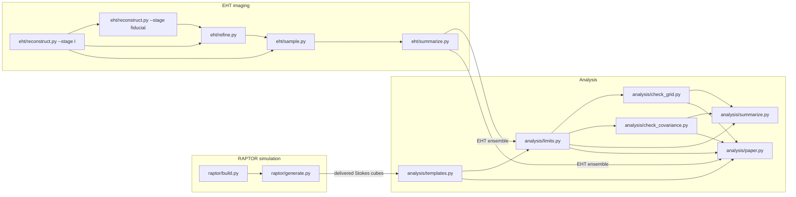

# 概览与基本概念

[← 返回文档索引](index.md)

M87\* EHT 轴子分析流水线用于检验环绕 M87\* 的超轻轴子云（ultralight axion cloud）所产生的双折射（birefringent）电矢量位置角（electric-vector position angle, EVPA）振荡。两个相互独立的上游部分——广义相对论磁流体力学（general-relativistic magnetohydrodynamics, GRMHD）吸积流的偏振光线追踪（ray tracing）模拟（`RAPTOR` 模拟）与 2017 年事件视界望远镜（Event Horizon Telescope, EHT）观测数据的偏振图像重建（EHT 成像）——可以按任意顺序运行或并行运行。下游分析部分将二者的产出结合，给出无量纲耦合常数 $c$ 的贝叶斯可信上限（credible upper limit）$c_{95}(\alpha)$。

## 流水线架构

| 部分 | 脚本 | Pixi 环境 | 主要输出产品 |
|---|---|---|---|
| `RAPTOR` 模拟 | `scripts/raptor/build.py`、`scripts/raptor/generate.py` | `raptor-build`（`linux-64`） | 已交付的 float64 Stokes 数据立方（`res-100/alpha-*/stokes.npy`、`res-400/background/...`） |
| EHT 成像 | `scripts/eht/reconstruct.py`、`scripts/eht/refine.py`、`scripts/eht/sample.py` | `eht-imaging` | 固定总强度（$I$）图像、精化后的基准仪器偏振泄漏（D 项，D-terms）以及 $4 \times 1000$ 幅带数值证书的偏振 FITS 抽样图像 |
| EHT 系综汇总 | `scripts/eht/summarize.py` | `eht-summary` | 按天汇总的 Stokes/EVPA 数组及 Paper VII 诊断量（`eht/ensemble/`） |
| 分析 | `scripts/analysis/templates.py`、`scripts/analysis/limits.py`、`scripts/analysis/check_grid.py`、`scripts/analysis/check_covariance.py`、`scripts/analysis/summarize.py`、`scripts/analysis/paper.py` | `default` | 响应模板、上限 $c_{95}(\alpha)$、敏感性检验、`RESULTS.md` 以及论文图、宏定义和表格 |

图中箭头表示“读取已校验的上游输出”。`scripts/raptor/generate.py` 运行光线追踪作业，并把 Stokes 数据立方交付到 `raptor/delivered/`。`scripts/analysis/paper.py` 还会读取冻结的 `RAPTOR` 任务计划、固定版本 `RAPTOR` 工作副本中的 `src/axion.c`、径向轮廓 CSV 表以及已交付的 400 像素无轴子数据立方。

## 科学计算流程

1. **`RAPTOR` 模拟**（[RAPTOR 模拟](raptor-simulation.md)）。在 141 个 BHAC GRMHD 快照（`data001600.dat` 至 `data003000.dat`，标签步长 10，时间间隔 $1\,t_g$）上，固定版本的 `RAPTOR` C 核心程序分别追踪：
   - 每个快照一幅 $100 \times 100$ 像素和一幅 $400 \times 400$ 像素的无轴子基线图像；
   - 对 $\alpha \in \{0.10, \dots, 0.44\}$ 的 8 个取值与 16 个均匀分布的轴子相位 $\psi_k = k\pi/8$（$k = 0, \dots, 15$）的每种组合，每个快照一幅 $100 \times 100$ 像素的有轴子响应图像。
   共计 $141 \times (2 + 8 \times 16) = 18\,330$ 个任务，最终交付为单位为 $\mathrm{Jy\,sr^{-1}}$ 的 float64 Stokes $(I, Q, U, V)$ 数据立方。
2. **EHT 成像**（[EHT 成像](eht-imaging.md)）。基于 `ehtim` 1.3.2，对 2017 年四个观测日（年积日 `95`、`96`、`100`、`101`，即 4 月 5、6、10、11 日）复现 EHT Paper VII 偏振成像流程：
   - 每天重建一幅固定的总强度（$I$）图像，并求解左右旋共享（$R=L$）的台站增益；
   - 执行 50 轮基准线偏振（$P = Q + iU$）成像与针对 `AZ`、`LM`、`PV` 三站的零先验前向 D 项拟合交替；
   - 利用带浮点对偶间隙（duality gap）证书的精确凸优化原始–对偶混合梯度（primal–dual hybrid gradient, PDHG）$P$ 求解器与 `L-BFGS-B` 前向 D 项重拟合，对每天的基准 D 项做 100 轮精化；
   - 根据四天精化解的散布做蒙特卡罗（Monte Carlo）抽样，每天抽取 1000 组 D 项（对预改正台站 `AA`、`AP`、`SM`、`JC` 叠加 1 % 的零均值残差），并对每次抽样求解一幅带数值证书的精确 $P$ 图像。
3. **分析**（[分析](analysis.md)）。将模拟的 Stokes 数据立方与共用的 $19\,\mu\mathrm{as}$ 匹配高斯核卷积，旋转到天空坐标系（$108^\circ$），并重采样到 $64 \times 64$、视场（field of view, FOV）为 $120\,\mu\mathrm{as}$ 的 EHT 天空网格上。通过 16 相位离散傅里叶变换提取每个像素（2D）和每个强度加权 $10^\circ$ 扇形孔径（1D）的一次谐波 EVPA 响应振幅 $A$ 与相位 $\phi$，再对快照取平均构成响应模板。在不查看日间差值大小的前提下，从 EHT 系综上选取高信噪比、高集中度的特征。基于两组相邻观测日的 EVPA 差值（$96 - 95$ 与 $101 - 100$）及三种协方差模型（`std`、`cor`、`cor_fixed_background`），采用对共享轴子相位 $\phi_0$ 边缘化的高斯似然（Gaussian likelihood）和 $c$ 的对数均匀先验（log-uniform prior），给出 95 % 可信上限 $c_{95}(\alpha)$，同时配套零数据对照（zero-data control）以及网格、先验和半样本协方差敏感性检验。

## 物理与偏振约定

### 物理尺度与轴子模型

注意：$r_g = GM/c^2$ 和 $t_g = GM/c^3$ 中的光速 $c$ 与无量纲模型耦合常数 $c$ 是不同的量。

| 符号 / 术语 | 数值 / 单位 | 代码 / YAML 位置 | 定义 |
|---|---|---|---|
| $M$ | $6.5 \times 10^9\,M_\odot$ | `shared.mass_solar` | M87\* 黑洞质量 |
| $D$ | $16.8\,\mathrm{Mpc}$ | `shared.distance_mpc` | 到 M87\* 的距离（写入 `RAPTOR` `model.in` 时换算为 $\mathrm{kpc}$） |
| $t_g$ | $8.893\,\mathrm{h}$（$32\,015.7\,\mathrm{s}$） | `PhysicalScale.tg_hours` | 引力时间尺度 $GM/c^3$ |
| $r_g$ | $3.819\,\mu\mathrm{as}$ | `PhysicalScale.angular_rg_uas` | 天空上的引力半径角大小 $GM/(c^2 D)$ |
| $\alpha$ | $0.10, \dots, 0.44$（无量纲） | `shared.alphas` | 引力精细结构常数（gravitational fine-structure constant）$GM\mu/(\hbar c)$；$\mu c^2 = \alpha \times 2.056 \times 10^{-20}\,\mathrm{eV}$ |
| 211 态 | $n = 2, l = 1, m = 1$ | `shared.principal_n` | 超辐射（superradiant）标量束缚态（主量子数 $n = n_r + l + 1 = 2$） |
| $\Omega(\alpha)$ | 无量纲；$\omega = \Omega/t_g$（$\mathrm{rad\,h^{-1}}$） | `physics.omega` | 小 $\alpha$ 主导阶振荡频率 $\Omega(\alpha) = \alpha\bigl(1 - \alpha^2/(2n^2)\bigr)$ |
| $c$ | 无量纲 | `likelihood.py` 中的 `g`、`couplings` | 标定轴子所致 EVPA 振荡幅度的模型耦合常数；代码不将其换算为 $\mathrm{GeV}^{-1}$ 单位的轴子–光子耦合 |
| $c_{95}$ | 无量纲 | `c95`、`log10_c95` | $c$ 在 `analysis.inference.credibility`（$0.95$）处的后验分位数 |
| $b(\alpha)$ | 无量纲 | `analysis.cloud` | 轴子云振幅标度因子 $0.03\,(\alpha / 0.05)^{1.75}$（`cloud_amplitude_scaling`） |
| $N_{\mathrm{ref}}$ | $0.1$（无量纲） | `raptor.response.reference_norm` | `RAPTOR` `AXION_NORM` 参考场归一化；响应模板以单位 $N_{\mathrm{ref}}$ 表示 |
| $\psi_k$, $\phi_0$ | $\mathrm{rad}$ | `AXION_PHASE`、`phase_count` | 模拟相位 $\psi_k = k\pi/8$（$k = 0, \dots, 15$）；推断讨厌参数（nuisance parameter）相位 $\phi_0 \in [0, 2\pi)$ |

### 偏振观测量与坐标约定

所有保存在 `.npy` 和 `.npz` 产品中的角度均以弧度为单位。天空位置角从北向东（east of north）量度。

| 符号 / 术语 | 单位 / 取值范围 | 代码位置 | 定义 |
|---|---|---|---|
| $I, Q, U, V$ | $\mathrm{Jy\,sr^{-1}}$（`RAPTOR`）或 FITS `BUNIT`（`Jy/pixel`，EHT） | `stokes.npy` | 斯托克斯参量（Stokes parameters）；通道轴顺序恒为 `[I, Q, U, V]` |
| $P$ | Stokes 亮度单位 | `Q + 1j * U` | 复线偏振；$\lvert P\rvert = \sqrt{Q^2 + U^2}$ |
| $\chi$（EVPA） | $\mathrm{rad}$，周期 $\pi$ | `evpa.finite_evpa` | 电矢量位置角 $\frac{1}{2}\arg(Q + iU)$；在 $Q = U = 0$ 处为 `NaN`（在 `eht:ensemble` 中 $I \le 0$ 处亦为 `NaN`） |
| $\operatorname{wrap}_\pi(\Delta\chi)$ | $[-\pi/2, \pi/2)\,\mathrm{rad}$ | `evpa.circular_difference` | 以 $\pi$ 为周期的主值分支角度差 |
| $R$ | $[0, 1]$ | `observations.moments` | 蒙特卡罗抽样上的圆合成长度（circular resultant length）$\lvert\langle e^{2i\chi}\rangle\rvert$（EVPA 完全一致时为 $1$） |
| $\lvert m\rvert_{\mathrm{net}}$, $\langle\lvert m\rvert\rangle$ | 无量纲 | `ensemble.global_diagnostics` | 净线偏振度（$\lvert\sum_i P_i\rvert / \sum_i I_i$）与平均解析线偏振度（$\sum_i \lvert P_i\rvert / \sum_i I_i$，Paper VII 式 12–13） |
| $\beta_2$ | 复数，无量纲 | `ensemble.global_diagnostics` | 绕网格中心的角向 $m=2$ 偏振模系数 $\sum_i P_i e^{-2i\varphi_i} / \sum_i I_i$（Paper VII 式 14） |

**空间数组方向约定：**
- **原生 EHT FITS 与系综数组**（`day-*/stokes.npy`）采用 `RA---SIN` / `DEC--SIN` 投影下的空间轴 `[y, x]`：东向偏移沿 `x` 增大而减小，北向偏移沿 `y` 增大而增大。
- **预处理后的模拟图像与模板数组**采用空间轴 `[x, y]`，其中第 `0` 轴指向西（`x = -East`），第 `1` 轴指向北（`y = +North`）。将原生 EHT 图转置（`[y, x] -> [x, y]`）即可使观测数据与模拟模板严格对齐到同一天空坐标网格，无需翻转任何 Stokes 符号。
- **零平移定中心：** EHT 图像直接使用其在 $64 \times 64$、$120\,\mu\mathrm{as}$ 公共网格上的重建位置，不做互相关平移（见 [EHT 成像](eht-imaging.md#与-eht-paper-vii-的已知差异)）。

## 核心设计准则

- **单一科学参数源**：模型中的所有物理常数、求解器容差、网格分辨率和先验区间都在 [`configs/experiment.yaml`](../../configs/experiment.yaml) 中仅定义一次，并由 `eht_axion/experiment.py` 严格校验（见[配置参考](configuration.md)）。
- **库函数不设科学参数默认值**：`eht_axion/` 中的公共函数全部以显式参数接收调用脚本传入的科学取值；`tests/test_experiment.py` 会扫描 `eht_axion/` 的抽象语法树（AST），拒绝短白名单（仅含并发执行与数组轴位置）之外的任何数值默认参数。
- **机器环境严格分离**：文件路径、线程数、并发进程数、CPU 绑定和内存上限仅通过命令行选项或唯一的 `.env` 数据文件给出，绝不写入 `configs/experiment.yaml`。全部路径都由三个根目录派生：`RAPTOR` 工作副本（`EHT_RAPTOR_SOURCE_ROOT`）、只读外部输入（`EHT_INPUT_ROOT`）与生成产物（`EHT_DATA_ROOT`）。
- **不可变阶段目录与溯源记录**：结果脚本通过 `stage_directory` 只写入全新目录，要求受版本控制的文件无未提交改动（`code_identity`），并生成记录配置、完整 `git_commit` 以及全部输入和输出路径的 `manifest.json`（见[数据布局与溯源机制](data-layout.md)）；外部输入文件的 SHA-256 写在 `configs/experiment.yaml` 与 `raptor/plan.json` 中。
