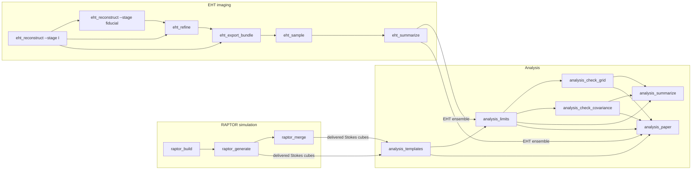

# 概览

## 用途

本页说明本仓库计算什么、由哪些部分组成，以及各部分的产品如何衔接。RAPTOR 模拟和 EHT 成像是
两个相互独立的输入，互不读取对方的产品；它们可以按任意顺序运行，也可以同时运行。分析部分读取
二者的产品，给出 M87\* 中轴子引起的 EVPA 振荡的耦合常数 $c$ 的上限。

## 输入

- M87\* 吸积流的 BHAC GRMHD 快照（`data<label>.dat`，标签从 1600 到 3000，步长 10），以及轴子场
  的两张径向轮廓表，由 RAPTOR 部分读取。
- 4 月 5、6、10、11 日（第 95、96、100、101 天）的四个 EHT 2017 M87\* 低频段 HOPS uvfits 文件、
  EHT 馈源旋转表和官方 EHT 成像脚本，由 EHT 成像部分读取。
- `experiment.yaml`，唯一的参数文件，所有脚本都读取它（[实验配置](experiment-config.md)）。

## 输出

- 交付的 RAPTOR Stokes 数据立方（`data/raptor/res-*/alpha-*/` 和 `data/raptor/res-400/background/`），
  见 [RAPTOR 生产](raptor-production.md)。
- EHT 系综：每天 1000 幅 D 项蒙特卡罗图像，按天汇总，见 [EHT 成像](eht-imaging.md)。
- 响应模板、似然特征、六种情形（1D 和 2D 观测量 × 三种协方差模型）的上限 $c_{95}(\alpha)$、
  其数值检验，以及论文所用的图、数字和表格，见[分析](analysis.md)。

## 运行方法

每个部分有自己的 Pixi 环境和脚本。完整命令行见 [RAPTOR 生产](raptor-production.md)、
[EHT 成像](eht-imaging.md)和[分析](analysis.md)的“运行方法”一节；环境列表见[开发](development.md)。

| 部分 | 脚本 | Pixi 环境 |
|---|---|---|
| RAPTOR 模拟 | `raptor_build.py`、`raptor_generate.py`、`raptor_merge.py` | `raptor-build` |
| EHT 成像 | `eht_reconstruct.py`、`eht_refine.py`、`eht_export_bundle.py`、`eht_sample.py` | `eht-imaging` |
| EHT 成像汇总 | `eht_summarize.py` | `eht-summary` |
| 分析 | `analysis_templates.py`、`analysis_limits.py`、`analysis_check_grid.py`、`analysis_check_covariance.py`、`analysis_summarize.py`、`analysis_paper.py` | `default` |

每个脚本都写入一个新的输出根目录，并拒绝覆盖已有结果。

## 细节

### 数据流

箭头表示“读取……的产品”。当所有作业都在同一个运行根目录中运行时，`raptor_generate` 可以自己交付
数据立方；`raptor_merge` 则从多台主机的作业根目录交付数据立方。

### 三个部分

- **RAPTOR 模拟。** 对 141 个 GRMHD 快照中的每一个，RAPTOR 光线追踪一幅 100 像素和一幅 400 像素
  的无轴子图像，并对 $\alpha$ 的 8 个取值和 16 个轴子相位 $k\pi/8$ 的每个组合追踪一幅 100 像素的
  有轴子图像：共 $141 \times (2 + 8 \times 16) = 18\,330$ 个任务。每个任务有一个内容标识符（决定该
  图像的全部内容的 SHA-256）。输出是每个 $\alpha$ 一个 float64 Stokes 数据立方（轴依次为时间、
  状态、x、y、Stokes），以及按时间分片的无轴子帧。
- **EHT 成像。** 用 ehtim 1.3.2 复现 EHT Paper VII 的偏振成像：由官方 EHT 脚本得到固定的总强度
  图像，求解共享的台站增益，进行偏振（P）成像与 D 项（仪器偏振泄漏）拟合的基准交替，对基准 D 项
  做精确的凸优化精化，再对 D 项做蒙特卡罗（每天 1000 次抽样，每次抽样求一幅精确的 P 图像）。
  按天组成的抽样系综就是分析部分的 EHT 输入。
- **分析。** 模拟图像经过模糊、旋转并重采样到 EHT 天空网格上；对每个快照，在 16 个相位上做一次
  谐波拟合，得到每个像素（2D）和每个孔径扇区（1D）的 EVPA 响应振幅和相位，对快照取平均即构成模板。
  特征（像素或扇区）在 EHT 系综上选取；两组日对 EVPA 差 96−95 和 101−100 及其 D 项散布构成数据和
  协方差。对轴子相位边缘化的高斯似然与 $c$ 的对数均匀先验一起，给出每个 $\alpha$ 的 95 % 可信
  上限 $c_{95}$。

### 各部分共同遵守的规则

- 每个脚本读取 `experiment.yaml` 的 `shared` 节和它自己的节；分析部分还读取它需要的 `raptor` 和
  `eht_imaging` 取值（例如 `raptor.response.reference_norm` 和 `eht_imaging.uncertainty_draws`）。
- `eht_axion` 中的库函数没有科学参数默认值；这些值由脚本从 `experiment.yaml` 传入。有一个单元测试
  强制检查这一点。
- 机器路径和执行设置（线程数、工作进程数、内存）是命令行选项或 `.env` 条目，从不写在 YAML 中。
- 每个写出科学产品的步骤都发布一个带 `manifest.json` 的阶段目录，记录参数以及输入、输出和代码的
  SHA-256 哈希值（[来源记录](provenance.md)）。D 项蒙特卡罗改用它自己的批次回执。
- EHT 图像按重建结果直接使用：EHT Paper VII 第 5.2 节通过互相关对齐图像，在本复现中这一对齐是
  零平移；没有重新定中心的选项。

## 相关页面

- [文档索引](index.md)
- [实验配置](experiment-config.md)
- [RAPTOR 生产](raptor-production.md)
- [EHT 成像](eht-imaging.md)
- [分析](analysis.md)
- [数据布局](data-layout.md)
