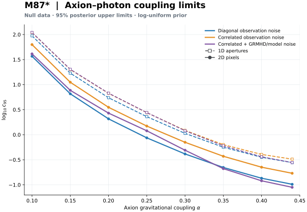

# Script-only pipeline: implementation and real-data validation

## Delivery locations

- Worktree: `/home/canoziia/eht-script-pipeline`
- Branch: `refactor/script-pipeline` (separate from original data branch)
- Read-only input: `/home/canoziia/MyProject/PHYS/EHT_ZC/shared_data/analysis-inputs/draft`
- New physical intermediates/results: `/home/canoziia/eht-pipeline-runs/`
- Main guide: [docs/SCRIPT_PIPELINE.md](../../docs/SCRIPT_PIPELINE.md)
- Portable environment: [Pixi quick start](../../docs/PIXI_QUICKSTART.md),
  [Pixi validation](PIXI_VALIDATION.md). The original evidence below used Nix;
  the separate Pixi rerun is reported without overwriting those outputs.

Original worktree, raw files, shared manifests, old intermediates and old figures were
not modified. The original three uncommitted audit/planning documents remain there.
Copies are included on this branch. No raw data were copied into this worktree.

## What is implemented

1. Explicitly named HDF5 Stokes conversion with correct time/state indexing and block layout
   validation (synthetic tests; actual historical HDF5 files are not available here).
2. Streaming RAPTOR cube/shard preprocessing; separate IQUV cache with blur, spin-2
   rotation, crop/resampling. Background processes state0 only.
3. Per-snapshot 1D/2D Fourier response `[A,phi,baseline]`, followed by non-pickled
   temporal mean/std/count products.
4. Four-day EHT metadata-identity alignment, candidate ranking,1572 selection, fixed
   relocation, explicit intensity/flux apertures, summaries and mask.
5. Saved circular-branch observation covariance; diagonal mode uses the same marginal
   variances as correlated mode. Input/template spatial selection is validated.
6. Re-estimated intrinsic GRMHD EVPA-difference sigma and histogram, with physical lag
   metadata, not an unexplained hardcoded final sigma.
7. Six posterior-limit curves, saved likelihood/CDF/boundary diagnostics, effective
   configuration/provenance and figures/tables.
8. Separate Figure-4 transport diagnostic CLI. Common/jonly/eq_jonly/fake names retain
   inferred—not verified—switch semantics. Both mask-before-blur and blur-before-mask
   are recorded and plotted. It is not an inference dependency.
9. Transactional stage directories, source/input hashes, output checksums, stale-cache
   rejection, input-directory containment guard and failed-rebuild rollback.

New production code never reads, executes or imports notebooks. Old notebooks remain
as provenance outside the new module tree; their remaining reference/diagnostic roles
are documented, not mislabeled as all dead code.

## Actual scientific-data execution

Started at existing RAPTOR IQUV arrays, **not** old processed products or final bundles:

- all8 α values, each141 GRMHD times ×17 states ×100²×4;
- high-resolution α=.3 background from15 time shards of the400² cube;
- four EHT4800-image pickle ensembles;
- the7 transport-diagnostic arrays.

Main profile: `configs/research.toml`; six curves,8 α points,120 coupling points,64 unique
initial phases, zero day-difference/null data. `configs/observed.toml` separately runs
actual April5→6 and April10→11 day differences, reusing physical caches without copies.

Current new-profile selection:1572 images/day,754 two-dimensional pixels,36 angular
points. GRMHD background MLE sigma≈2.57868°, pooled from104052 finite differences at
26.67974h lag. This lag is explicitly **not exact24h**.

### Main figure



Local PNG/PDF/SVG and per-dimension views:

```text
/home/canoziia/eht-pipeline-runs/research/08_figures/
/home/canoziia/eht-pipeline-runs/observed/08_figures/
```

Diagnostic figures:

```text
/home/canoziia/eht-pipeline-runs/research/09_diagnostics/eht_selection.png
/home/canoziia/eht-pipeline-runs/research/09_diagnostics/grmhd_background.png
/home/canoziia/eht-pipeline-runs/transport/figures/
```

## Verification evidence

- Tests: **204 passed,1 skipped**. The skip is the optional legacy-utils module that
  imports statsmodels; install `.[legacy,dev]` to run it. New scientific pipeline and
  HDF5/rotation/DFT/aperture/covariance/likelihood/transaction tests all run.
- Synthetic end-to-end pipeline produces all6 curves and figures; repeats do not
  rewrite cached arrays. Tests also reject stale configuration, alpha/background
  mismatches, source-inside-output replacement and mixed-prior plots.
- Ruff/compileall/diff whitespace checks pass.
- Wheel installation into an isolated target and module/console-entrypoint execution
  outside the source directory pass.
- Full real-data cache replay reports **25 cache hits**, no science recomputation.
  Hashing raw inputs still performs disk I/O; cache does not skip integrity checks.
- Legacy numerical compatibility: all48 historical cuts agree to≤3.4e-15 dex;
  [legacy-regression.json](legacy-regression.json). Compatibility is not a claim
  that the old formulas were correct.
- Sampled RAPTOR preprocessing against old saved Stokes:9 time/state images, max
  channel difference/peak≈1.17e-15; max EVPA difference≈1.82e-14rad.
  [historical_comparison.json](historical_comparison.json).
- Current ensemble-MLE topset overlaps previous histogram-based corrected profile in
  1400/1572 identities. This is an estimator/selection change, not a one-bug delta.
- Null grid convergence:120→240 coupling points max difference≈0.001254dex;
 64→128 initial phases max difference<1e-12dex, all6 curves checked.
  [null-convergence.json](null-convergence.json).
- Observed grid convergence:120→240 coupling points max difference≈0.007964dex;
 64→128 phases max difference≈0.000411dex, all6 curves checked.
  [observed-convergence.json](observed-convergence.json). This tests discretization,
  not upper-bound independence or correctness of the adopted noise model.

Stage products total≈3.53GB. Summed stage execution time is≈249s for the final recorded
runs, excluding input hashing, process overhead and earlier development reruns.2D full
inference is the dominant numerical cost. Per-stage timing/signatures are in
[stage-summary.json](stage-summary.json). Runtime depends on machine/BLAS/cache load.

## Important methodological distinctions

The new default is a **research profile**, not a frozen paper result. Relative to the
previous reconstructed profile it restores intensity-weighted1D, uses ensemble MLE
rather than histogram-main-peak fitting, re-estimates background noise, corrects aperture
quadrature and the five-day phase. Multiple changes affect curves simultaneously.

The full-mode limit can be stronger than cor despite larger covariance: a parameter-
dependent Gaussian normalization/logdet is part of the adopted probability model.
This is not by itself evidence of a coding error or proof of a better physical model.

Remaining author/method confirmation:

- historical FOV/angular calibration, rotation and Stokes sky basis;
- principal n=4 frequency convention vs draft211 mode;
- physical meaning/time correlations of shared template uncertainties;
- scalar/diagonal GRMHD and model-error approximations;
- approximate background lag vs exact24h target;
- Gaussian ensemble interpretation, manual mask and fixed relocation offsets;
- finite coupling prior and bounds. Null posterior is sensitive to the lower prior bound.

Observed α=.1 1D results have≈1.7–3.3% posterior mass in the last coupling interval
near the upper bound1000; they must be treated as potentially upper-truncated.
The observed plots are exploratory outputs, not robust bound-independent constraints.

The upstream GRMHD simulation, RAPTOR transfer configuration and EHT visibility imaging
are not reconstructed here. Input archives begin at simulated/reconstructed images.
Constant sources and unresolved conversions: [M87_CONSTANTS_AUDIT.md](../../M87_CONSTANTS_AUDIT.md).

## How to inspect or continue

```bash
cd /home/canoziia/eht-script-pipeline
pixi install --locked
pixi run check

# Read-only sources, all new products outside MyProject:
pixi run pipeline --config configs/research.toml \
  --input-root /home/canoziia/MyProject/PHYS/EHT_ZC/shared_data/analysis-inputs/draft \
  --output-root /home/canoziia/MyProject/PHYS/eht-pipeline-runs/my-pixi-run --trust-pickle
```

Prefer reviewing physical definitions one stage at a time. Different configuration or
source code yields stale-cache errors; choose a new output root or explicitly rebuild
appropriate stages. The observed run's symlinked upstream directories intentionally share the validated
research caches. The orchestrator rejects rebuilding those linked stage roots; use
independent stage directories for a new processing configuration.
